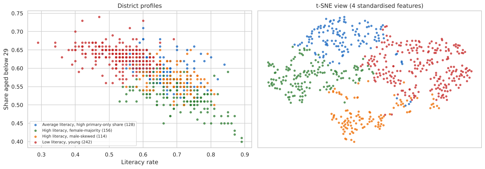
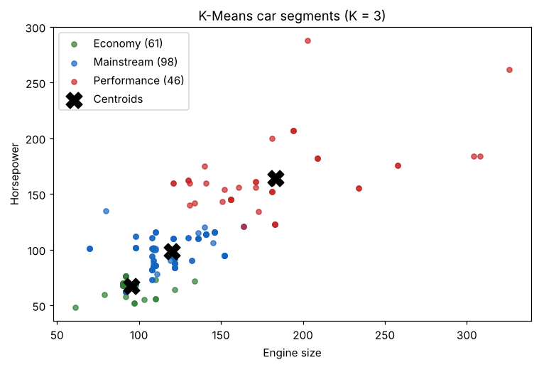
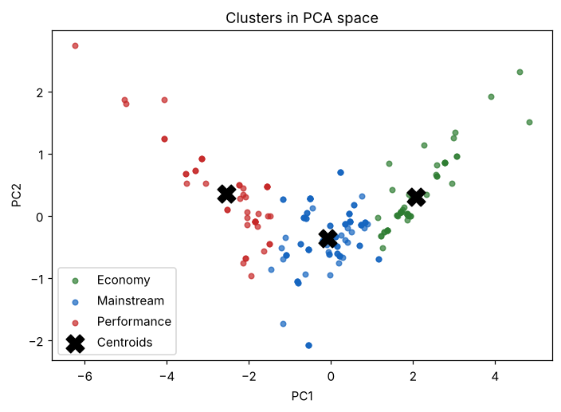

# K-Means Clustering: Indian Census Districts and Car Segments

Two applications of K-Means with the same discipline: standardise first, choose K from several criteria rather than one, interpret the centroids in original units, and check that the clusters survive a change of random seed.

  

| Project | Data | K | Silhouette | Stability (ARI, 20 seeds) | Headline |
|---|---|---|---|---|---|
| [Census districts](census-districts/) | 640 districts, 4 indicators | 4 | 0.280 | mean 0.995 | Four demographic profiles recover India's regional patterns without any location data. Several large states span 3–4 profiles. |
| [Car segments](car-segments/) | 205 cars, 4 specs | 3 | 0.454 | mean 0.998 | Economy, mainstream and performance segments along one size-versus-efficiency axis (PC1 = 84% of variance). |

## 1. Census districts: demographic profiles

| Profile | Districts | Literacy | Women per 1,000 men | Primary-only education | Aged < 29 | Leading states |
|---|---|---|---|---|---|---|
| Low literacy, young | 242 | 53% | 938 | 15% | 63% | Uttar Pradesh, Madhya Pradesh, Bihar, Rajasthan |
| High literacy, female-majority | 156 | 71% | 1,003 | 17% | 52% | Tamil Nadu, Andhra Pradesh, Karnataka, Kerala |
| High literacy, male-skewed | 114 | 68% | 876 | 15% | 58% | Haryana, Punjab |
| Average literacy, high primary-only share | 128 | 66% | 950 | 23% | 60% | Gujarat, Assam, Karnataka |

- **Choosing K:** the large WCSS drops end at K = 4, the silhouette has a local peak there, and the smallest cluster still holds 114 districts.
- Uttar Pradesh, Maharashtra, Odisha, Karnataka and Assam contain districts from three or four profiles. That argues for district-level rather than state-level programme design.
- A silhouette of 0.28 means the profiles summarise a continuum. The boundaries are gradual, but the partition is highly reproducible.

<p align="center"></p>

## 2. Car segments

| Segment | Cars | Engine size | Horsepower | City / highway mpg |
|---|---|---|---|---|
| Economy | 61 | 95 | 67 | 33 / 39 |
| Mainstream | 98 | 120 | 99 | 24 / 29 |
| Performance | 46 | 183 | 164 | 18 / 23 |

- **Choosing K:** the largest inertia drop happens moving from K = 2 to K = 3 (`max_drop_K = 3`, as the exercise specifies).
- PC1 explains 83.7% of the variance and contrasts size/power with fuel efficiency. The segments are positions along that axis.
- 94 of 205 rows duplicate another car's specification, which is worth deduplicating in a production segmentation.

<p align="center"> </p>

## Repository structure

```
kmeans-clustering-census-cars/
├── census-districts/
│   ├── data/kmeans_census_data.csv
│   ├── notebooks/kmeans_census_districts.ipynb
│   └── outputs/{figures,metrics}/
├── car-segments/
│   ├── data/carprices_dataset.csv
│   ├── starter/Kmeans_Clustering_Activity_Execrise.ipynb   # original exercise template (unchanged)
│   ├── notebooks/kmeans_car_segments.ipynb
│   └── outputs/{figures,metrics}/
├── reports/KMeans_Clustering_Report.docx
├── requirements.txt   LICENSE   README.md
```

## How to run

```bash
git clone https://github.com/kashiprasadtn/kmeans-clustering-census-cars.git
cd kmeans-clustering-census-cars
python -m venv .venv && source .venv/bin/activate   # Windows: .venv\Scripts\activate
pip install -r requirements.txt
jupyter lab
```

Each notebook runs in under a minute. The car notebook uses `random_state = 9001`, as the exercise specifies; the census notebook uses `random_state = 0`.

## Data and attribution

- **Census districts:** district-level indicators derived from the Census of India 2011 (literacy rate, gender ratio, share with primary education, share aged below 29). State names follow the census era (for example, Orissa).
- **Cars:** four technical columns from the *Car Price Prediction* dataset (Kaggle), derived from the UCI *Automobile* dataset (1985).
- Both datasets were supplied through upGrad coursework and are included for educational, non-commercial use.
- The car starter notebook is upGrad course material, kept unchanged. The census notebook extends an upGrad K-Means demo, which is not reproduced. All completed analysis is my own.
- Coursework completed during my MS in Artificial Intelligence (Liverpool John Moores University, delivered via upGrad); published to GitHub in November 2026.

## Licence

Code is released under the [MIT License](LICENSE). The datasets and starter notebook are excluded.
